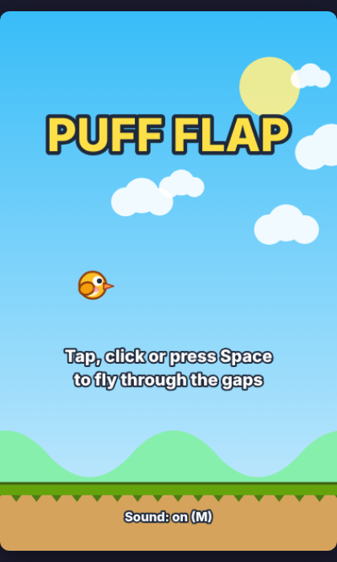
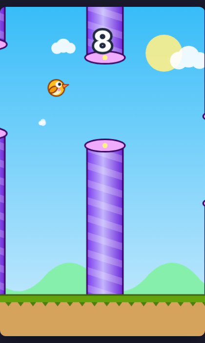
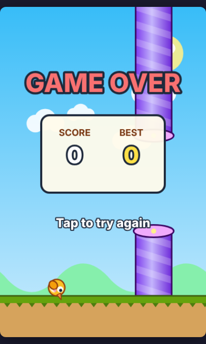
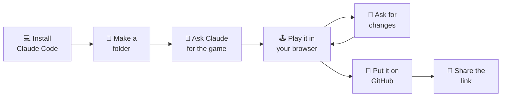
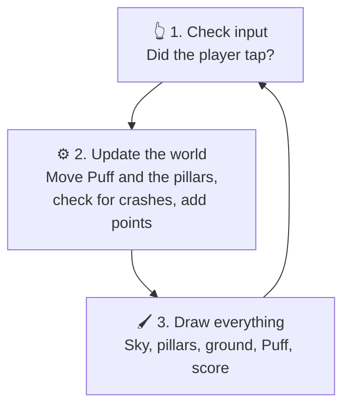
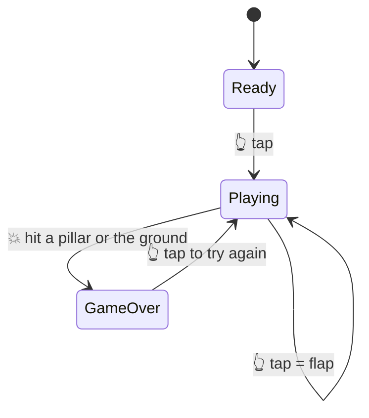
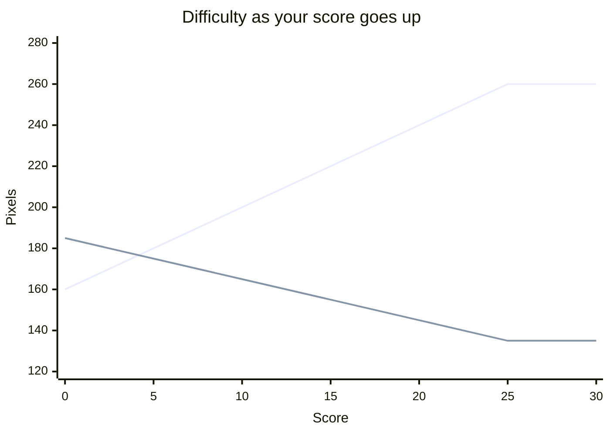

<div align="center">

# 🐤 Puff Flap

### Making a Really Fun Video Game with Claude Code for Complete Beginners

**A tap-to-fly game you can build in about 15 minutes, with no coding experience.**

### 👉 [**Play it now**](https://swiftverse.github.io/puff-flap/) 👈

&nbsp;
&nbsp;


</div>

---

## 🎮 What is this?

Puff Flap is a small arcade game. You tap to make Puff flap upward, gravity pulls him down, and you steer him through the gaps between candy-striped pillars. Every pillar you pass is one point. The longer you survive, the faster and tighter it gets.

The whole game lives in **one file** (`index.html`). There's nothing to install to play it. It runs in any browser, on a laptop or a phone.

I made it with **Claude Code**, an AI coding assistant. I told it what I wanted in plain English and it wrote the code. This page shows you how to do the same thing yourself, step by step.

---

## 🧭 The whole journey at a glance



| ⏱️ Time | 🧠 Skill needed | 💰 What you need |
|---|---|---|
| About 15–20 minutes | None. If you can copy and paste, you can do this | A computer, a [Claude subscription](https://claude.com/pricing) and a free [GitHub](https://github.com) account |

---

## 🛠️ Step 1: Install Claude Code

Open a **terminal**. That's the window where you type commands.

- 🍎 **Mac:** press `Cmd + Space`, type **Terminal**, press Enter
- 🪟 **Windows:** press the Start key, type **PowerShell**, press Enter
- 🐧 **Linux:** you probably already know 😄

Copy the line for your computer, paste it in, and press Enter:

**Mac, Linux or WSL**
```bash
curl -fsSL https://claude.ai/install.sh | bash
```

**Windows PowerShell**
```powershell
irm https://claude.ai/install.ps1 | iex
```

It won't show progress while it downloads, so give it a minute. When it's finished, **close the terminal, open a new one**, and check it worked:

```bash
claude --version
```

If you see a version number, you're ready. ✅

> 💡 **Rather not use a terminal?** You can also use Claude Code in the Claude desktop app (the **Code** tab) or in your browser at [claude.ai/code](https://claude.ai/code). The prompts below work the same way there.

---

## 📁 Step 2: Make a folder for your game

In the terminal, type these lines one at a time:

```bash
mkdir puff-flap
cd puff-flap
claude
```

The first line makes a folder, the second moves you into it, and the third starts Claude Code. The first time, it will ask you to log in with your Claude account.

---

## 💬 Step 3: Ask Claude to build the game

This is the fun part. Copy this whole message and paste it into Claude Code:

```text
Make me a tap-to-fly arcade game called "Puff Flap" in a single index.html file
using HTML, CSS and JavaScript with a canvas. No libraries, no image or sound files.

- The player is Puff, a round yellow bird drawn with code, with a flapping wing.
- Tap, click, Space or the Up arrow makes Puff flap upward. Gravity pulls him down.
- Purple candy-striped pillars scroll in from the right with a gap to fly through.
- One point for each pillar passed. Hitting a pillar or the ground ends the game.
- The game slowly speeds up and the gaps get a little smaller as the score goes up.
- Show a title screen, a big score while playing, and a game over panel with the
  score and best score. Save the best score in the browser.
- Add simple sound effects made with the Web Audio API, and M to mute.
- Add little puff particles when flapping and a screen shake when you crash.
- It must work on phones: scale to fit the screen and respond to taps.
- Put the important numbers (gravity, flap power, speed, gap size) at the top
  of the file with comments, so a beginner can change them.
- When you're done, tell me how to open it.
```

Claude will think for a moment and then create `index.html`. It may ask permission before it writes the file. Say **yes**. 👍

> 🧠 **Why such a detailed prompt?** The clearer you are, the closer the first version is to what you pictured. You don't need to know any code words. Just describe what you'd see and do when you play.

---

## 🕹️ Step 4: Play your game

Open the folder and **double-click `index.html`**. It opens in your browser. Tap or press Space to fly.

Or ask Claude to open it for you:

```text
Open index.html in my browser
```

🎉 **That's it. You made a video game.**

---

## 🎨 Step 5: Make it yours

Now ask for changes in plain English, one at a time. After each one, refresh the browser tab to see the result. Some ideas:

| Want this? | Type this into Claude Code |
|---|---|
| 🌙 Night mode | `Make the sky a dark night with stars and a moon` |
| 🪙 Coins | `Add a spinning coin in some gaps that gives 5 bonus points` |
| 😌 Easier game | `Make the game easier for my little brother` |
| 🎵 Music | `Add a short looping background tune made with Web Audio, and keep M as mute` |
| 🏅 Medals | `Show a bronze, silver or gold medal on the game over screen for 10, 25 and 50 points` |
| 🐉 New hero | `Change Puff into a tiny dragon that breathes a puff of fire when it flaps` |

If something breaks, don't worry. Describe what you see:

```text
When I press Space nothing happens. Can you find out why and fix it?
```

> 🔧 **Try it without Claude too.** Open `index.html` in any text editor. At the very top you'll see numbers like `GRAVITY` and `FLAP_POWER`. Change one, save, refresh the browser, and feel the difference. That's real game design.

---

## 🧠 How the game works (the simple version)

Every game is a loop that runs about 60 times a second. Each time round, it does three things:



The game is also always in one of three **states**:



### 📈 How it gets harder

The more points you score, the faster the pillars move and the smaller the gaps get, until both hit their limits at 25 points:



### 🎛️ The numbers you can change

These sit at the top of `index.html`:

| Setting | What it does | Try |
|---|---|---|
| `GRAVITY` | How fast Puff falls | `1000` floaty 🪶 / `2000` heavy 🪨 |
| `FLAP_POWER` | How hard each flap pushes up | `-350` weak / `-500` strong |
| `START_GAP` | Gap size at the start | `230` for an easy game |
| `MIN_GAP` | The smallest the gap ever gets | `110` for a hard game |
| `START_SPEED` | How fast pillars move at first | `120` slow / `220` fast |
| `MAX_SPEED` | Top speed | `350` for chaos 😅 |
| `SPACING` | Distance between pillars | `180` close / `300` far |

---

## 🚀 Step 6: Put your game online (free)

GitHub Pages turns your file into a real website anyone can open.

**Option A: ask Claude Code to do it** 🤖

If you have the [GitHub CLI](https://cli.github.com) installed and logged in (`gh auth login`), type:

```text
Put this project in a new public GitHub repo called puff-flap,
push it, and turn on GitHub Pages from the main branch.
Then give me the link to play the game.
```

**Option B: do it in your browser** 🖱️

1. Go to [github.com/new](https://github.com/new)
2. Name the repository `puff-flap`, set it to **Public**, and click **Create repository**
3. Click **uploading an existing file**, drag in your files, and click **Commit changes**
4. Open **Settings → Pages**
5. Under **Branch**, choose `main`, then `/ (root)`, and click **Save**
6. Wait a minute or two and refresh. Your link appears at the top:
   `https://YOUR-USERNAME.github.io/puff-flap/`

---

## 📣 Step 7: Share it

Post the link and dare your friends to beat your score. 🏆 It works on phones, so people can play straight from your post.

---

## 🆘 If something goes wrong

| Problem | Fix |
|---|---|
| `claude` isn't found after installing | Close the terminal and open a new one. Still stuck? See the [install troubleshooting guide](https://code.claude.com/docs/en/troubleshoot-install) |
| The game shows a blank screen | Ask Claude: `The game shows a blank screen. Please check for errors and fix it` |
| No sound | Tap the game once first (browsers block sound until you interact), and press **M** in case it's muted |
| The GitHub Pages link shows 404 | Wait 2 minutes, and check the file is named exactly `index.html` |
| Best score doesn't save | Private or incognito windows forget it when you close them. That's normal |

---

## 📂 What's in this repo

```text
puff-flap/
├── index.html      🎮 the whole game
├── README.md       📖 this page
├── LICENSE         📜 MIT, use it however you like
└── assets/         🖼️ screenshots for this page
```

---

## 📚 Learn more

- 📘 [Claude Code docs](https://code.claude.com/docs/en/overview)
- 🎓 [Claude Code 101, a free course](https://academy.claude.com/courses/claude-code-101)
- 🖌️ [Canvas tutorial from MDN](https://developer.mozilla.org/en-US/docs/Web/API/Canvas_API/Tutorial), if you want to understand the drawing code

---

<div align="center">

Made by **Amit Shrivastava** with 🤖 Claude Code

⭐ If this helped you make your first game, give the repo a star!

</div>
